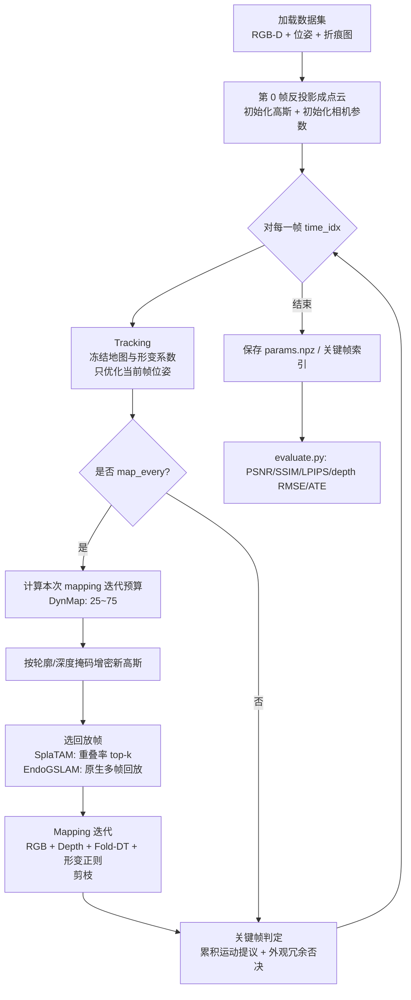

# KFS⁴LAM 运行（训练）与数据集构建指南

本文档说明两件事：

1. **怎么在这个仓库里跑起来（即“训练”）**——入口、命令、配置解析、内部优化循环、产物。
2. **数据是怎么组织的**——官方数据来源、目录结构、位姿/深度/内参/折痕图的格式与单位、以及被代码强制的隐含约定。

> 所有结论都来自仓库内代码：`run.py`、`configs/*.json`、`final/<backbone>/scripts/kfs4lam.py`、`final/<backbone>/datasets/gradslam_datasets/*`、`modules/*.py`、`evaluation/*.py`。

---

## 0. 先明确：“训练”在这里指什么

KFS⁴LAM **没有离线训练阶段，也不需要任何预训练权重**。

- 它是一套**逐序列的在线 SLAM 优化**（backbone 为 SplaTAM / EndoGSLAM）：输入一条带位姿的 RGB-D 内窥镜序列（外加折痕概率图），在 GPU 上边跑边优化
  - **相机位姿**（tracking，冻结地图，只优化当前帧位姿）
  - **3D 高斯地图**（mapping，优化高斯均值/颜色/旋转/不透明度/尺度）
  - **受限时序形变系数**（`deform_coeffs`，随时间把高斯均值搬到当前时刻）
  - **高斯上的折痕属性**（`fold_colors`，用来渲染折痕图并做结构监督）
- 跑完得到的是**该序列的重建结果**（`params.npz`）+ 评估指标，而不是一个可跨序列复用的模型文件。
- 因此“开始训练”= **准备好一条序列的数据 + 选中一个配置 + 执行 `python run.py ...`**。

```
论文中的 “Full” 配置  =  final/splatam|endogslam/configs/<dataset>/<sequence>.json
论文中的所有消融配置   =  ablations/<backbone>/<variant>/<dataset>/<sequence>.json
（configs/experiments.json 是这些配置的总索引）
```

---

## 1. 环境准备

### 1.1 依赖与 CUDA 扩展

`USAGE.md` 给出的官方环境是 Python 3.10 + CUDA 版 PyTorch（论文用 V100 32GB），并且**必须编译深度可用的高斯光栅化器**，且光栅化器要和 PyTorch/CUDA 版本配套。

```bash
# 1) 先装与本机驱动匹配的 torch（示例为 cu118）
python -m pip install torch==2.1.2 torchvision==0.16.2 --index-url https://download.pytorch.org/whl/cu118

# 2) 仓库依赖
python -m pip install -r requirements.txt

# 3) 主渲染器（depth-enabled，固定 commit，别换成 MonoGS 那个）
python -m pip install 'git+https://github.com/JonathonLuiten/diff-gaussian-rasterization-w-depth.git@cb65e4b86bc3bd8ed42174b72a62e8d3a3a71110'

# 4) 自检：能列出所有可用配置
python run.py --list
```

可选（只有跑 `monogs_frame_selection` 消融才需要）：

```bash
(cd third_party/monogs_rasterizer && python setup.py build_ext --inplace)
```

> 该适配器以**独立模块名**加载 MonoGS 渲染器，**不要**把它当成主渲染器替换掉 `diff_gaussian_rasterization`。

### 1.2 本机（N76GPU56，2×RTX 4090）现状提示

- 已就绪：`~/miniconda3/envs/gs`（python 3.10 + torch 2.1.2+cu118）、CUDA 11.8 工具链、`source ~/activate_gs.sh` 一键环境。
  → **1.1 里的步骤 1) 在本机要跳过**，重复 `pip install torch` 会覆盖 conda 装好的 cu118 构建。
- 尚未安装：`diff_gaussian_rasterization`（主渲染器）、`open3d` 等 `requirements.txt` 里的包。首次运行前按 1.1 的步骤 2)、3) 装上。
- 该环境的两个硬约束（否则 import 会炸）：
  - `numpy < 2`（torch 2.1 的 `_ARRAY_API not found`）
  - `setuptools < 81`（84 起删掉 `pkg_resources`，torch 的 `cpp_extension` 依赖它）
- 编译扩展时用 `TORCH_CUDA_ARCH_LIST=8.9+PTX`（40 系），`activate_gs.sh` 已设置。

---

## 2. 最短路径：从冒烟测试到正式运行

### 2.1 先看配置被解析成什么（不占显存）

```bash
python run.py --backbone splatam --dataset c3vd_v2 --sequence c1_rectum_t2_v1 \
  --dataset-root /path/to/C3VD_V2_ROOT --fold-root /path/to/FOLD_ROOT \
  --output outputs/splatam_rectum --dry-run
```

`--dry-run` 会把占位符替换后的**完整生效配置**打印出来。建议第一步就核对：

- `data.basedir` / `data.sequence`
- `fold_seg_loss.root`（以及 `enable`）
- `mapping.num_iters`、`tracking.num_iters`
- `keyframe_selection_mode`

### 2.2 正式跑两条 backbone

```bash
# SplaTAM backbone
python run.py --backbone splatam --dataset c3vd_v2 \
  --sequence c1_rectum_t2_v1 --dataset-root /path/to/C3VD_V2_ROOT \
  --fold-root /path/to/FOLD_ROOT --output outputs/splatam_rectum --gpu 0

# EndoGSLAM backbone
python run.py --backbone endogslam --dataset c3vd_v2 \
  --sequence c1_rectum_t2_v1 --dataset-root /path/to/C3VD_V2_ROOT \
  --fold-root /path/to/FOLD_ROOT --output outputs/endogslam_rectum --gpu 0
```

C3VD（v1）只要把 `--dataset c3vd` 和 `--dataset-root` 换成 v1 的根目录即可。

### 2.3 冒烟测试（只验证能跑通，不产出论文数值）

```bash
python run.py --backbone splatam --dataset c3vd --sequence trans_t2_b \
  --dataset-root /path/to/C3VD_ROOT --fold-root /path/to/FOLD_ROOT \
  --output outputs/smoke --gpu 0 --frames 5 --mapping-iters 5 --tracking-iters 5
```

注意：
- `--frames N` 把 `data.end` 改成 `start+N`，并令 `num_frames=-1`；
- `--mapping-iters` 会**关闭 DynMap**（`dynamic_mapping_iters.enable=False`）；
- 这三个参数是方便快速验证的，**不能用来复现论文数字**。

### 2.4 显存不够时

```bash
python run.py ... --cpu-offload
```

它只把 autograd 保存的张量换到 CPU（`torch.autograd.graph.save_on_cpu`），**不改变损失定义**。文档中提到这是某个固定关键帧形变对照实验（显存爆掉）才需要的开关。

---

## 3. `run.py` 参数与配置解析逻辑

| 参数 | 默认值 | 说明 |
|---|---|---|
| `--backbone` | `splatam` | `splatam` 或 `endogslam`，决定加载 `final/<backbone>/scripts/kfs4lam.py` |
| `--variant` | `full` | 消融名，见 `ablations/README.md`；`full` 是论文主方法 |
| `--dataset` | `c3vd_v2` | `c3vd` 或 `c3vd_v2`，同时决定相机内参 yaml |
| `--sequence` | `c1_rectum_t2_v1` | 序列名，必须与 `configs/experiments.json` 中某条完全一致 |
| `--dataset-root` | `data` | 替换配置里的 `${DATASET_ROOT}` |
| `--fold-root` | 空 | 替换 `${FOLD_ROOT}`；**开启折痕监督的配置必须提供** |
| `--output` | `outputs/run` | 运行目录；其父目录替换 `${OUTPUT_PARENT}`，末段替换 `${RUN_NAME}` |
| `--gpu` | `0` | 写入 `CUDA_VISIBLE_DEVICES`，进程内统一用 `cuda:0` |
| `--list` | — | 列出所有 `backbone: variant` 组合后退出 |
| `--dry-run` | — | 打印替换后的配置后退出 |
| `--frames` / `--mapping-iters` / `--tracking-iters` | — | 冒烟测试覆盖项 |
| `--cpu-offload` | — | autograd 保存张量搬到 CPU |

解析流程（`run.py: resolve_config`）：

1. 读 `configs/experiments.json`，按 `(backbone, variant, dataset, sequence)` **四元组精确匹配**，取到 `config` 路径；匹配不到直接报 `No exported configuration for the requested combination; use --list.`
2. 读该 JSON，递归替换占位符：
   - `${DATASET_ROOT}`、`${FOLD_ROOT}`、`${OUTPUT_PARENT}`、`${RUN_NAME}`、`${MODULE_ROOT}`
   - `${CAMERA_CONFIG}` = `final/<backbone>/configs/data/<dataset>.yaml`
3. 校验：若 `fold_seg_loss.enable` 为真而没有 `--fold-root` → 报错。
4. 强制 `primary_device='cuda:0'`、`use_wandb=False`（本地跑不会上传 wandb）。
5. 建输出目录，写 `effective_config.json`，然后把仓库根、`modules/`、`final/<backbone>/` 加入 `sys.path`。
6. 动态加载 `final/<backbone>/scripts/kfs4lam.py`，按需打补丁：
   - SplaTAM + 折痕监督 → `modules.structure_guided.install(module, c)`
   - SplaTAM + 关键帧消融 → `modules.selection_ablations.attach(module, c)`
   - EndoGSLAM + 折痕监督 → `modules.structure_guided_endogslam.install_stable_cache(module)`
7. `seed_everything(c['seed'])`，调用 `module.rgbd_slam(c)`。

> ⚠️ **易踩的坑**：`--sequence` 只用于**选取**配置条目，代码**不会**把它写进 `data.sequence`。真正的序列名来自配置 JSON 里的 `data.sequence`。如果你复制一份配置改成别的序列，记得两处一起改，否则会静默地跑错序列（并因为找不到文件报错）。

---

## 4. 一次运行内部在做什么（“训练循环”）

```
准备数据 ─▶ 第 0 帧初始化高斯 ─▶ 逐帧循环 ─▶ 保存 params.npz ─▶ 最终评估
```



关键行为（与 `USAGE.md` 的 “Implementation conventions” 一致，并已对照代码核实）：

- **位姿一律用 world-to-camera**：数据集给的是 `pose`（camera-to-world，相对第 0 帧），循环里立刻 `gt_w2c = inv(gt_pose)`。
- **SplaTAM 是“先 mapping 后选关键帧”**：`map_every: 1` 表示每帧都做 mapping；关键帧判定在 mapping 之后（`_accum_motion_keyframe_decision` + `_redundancy_gate`），选中后把 `color/depth/fold_seg` 存进 `keyframe_list` 供后续回放。
- **累积运动是“平移分量变化量”作为运动代理**，不是世界系相机中心位移（相机中心应为 `-R.T @ t`）。
- **DynMap 迭代预算**：`dynamic_mapping_num_iters` 依据上一关键帧间隔与 `base_gap=8`、`power=1.0`、`max_scale=3.0` 把 25 次基准拉伸到最多 75 次（`min_iters=25, max_iters=75`）。注意“预算相等 ≠ 实际迭代次数相等”，因为不同关键帧历史导致回放帧不同。
- **`mapping_window_size: -1`**：内部得到 `k = window-2 = -3`，在重叠率排序后的候选上做 `[:k]` 切片，效果是“几乎不限制历史回放帧数”（只丢弃排列末尾 3 个），再强制加入最近一个关键帧和当前帧。
- **Tracking**：`num_iters: 15`，学习率只给 `cam_unnorm_rots=0.002`、`cam_trans=0.005`，其余参数学习率为 0 → 地图被冻结。
- **Fold 监督**：渲染折痕图时**对 `fold_colors` 做 detach**（不让优化器靠“改颜色”骗过损失），梯度只作用到高斯几何。导出配置走 `fold_loss_variant.mode = "historical_boundary_dt"`：损失是「渲染折痕的 Sobel 边界幅值」与「目标折痕的截断距离变换（stop-gradient，上限 **10 px**）」的单边均值乘积；目标边界由 `boundary_q90` 归一化后 `>0.20` 判定（若为空再退到 99 分位）。**阈值化只出现在构造目标 DT 的这一步**，高斯上存的折痕属性本身不二值化。为省显存还可把 Fold 图的反向放到 RGB-D 之后单独做（`memory_efficient_backward: true`）。
- **时序形变**：6 个系数（`num_basis: 2`）作用于基 `[u, sin(pi*u)]`；折痕响应越强，位移惩罚按 `1 - 0.5*f` 放松（`fold_soft_alpha: 0.5`）。

### 4.1 损失项（以 `final/splatam/configs/c3vd_v2/c1_rectum_t2_v1.json` 为例）

| 项 | 权重 | 作用 |
|---|---|---|
| `im`（RGB，L1+SSIM） | 1.0（tracking 0.5） | 光度 |
| `depth`（L1） | 1.0 | 几何；深度是**输入观测** |
| `fold`（Boundary-DT） | `fold_seg_loss.weight = 1.0`（乘 `im` 权重） | 折痕边界监督 |
| `def_mag` | 0.001 | 形变幅度惩罚 |
| `def_temp` | 0.01 | 时间维平滑 |
| `def_mean` | 0.01 | 全局位移惩罚 |

### 4.2 运行产物

```
<output>/
├── effective_config.json          # 占位符已替换的生效配置（评估脚本也读它）
├── params.npz                     # 高斯参数 + cam_unnorm_rots/cam_trans +
│                                  # deform_coeffs / fold_colors / intrinsics /
│                                  # w2c / gt_w2c_all_frames / keyframe_time_indices
└── eval/                          # 评估帧的渲染与指标
    ├── psnr.txt / ssim.txt / lpips.txt / rmse.txt / l1.txt   (SplaTAM 逐帧指标)
    ├── plots/0000.png, 0007.png, 0015.png ...                (逐帧 RGB-D 对比图)
    ├── metrics.png                                          (指标曲线)
    ├── color/color_0000.png ...                             (EndoGSLAM 渲染帧)
    └── est_w2c.txt / gt_train_w2c.txt                       (EndoGSLAM 位姿)
```

关键帧索引文件 `keyframe_time_indices<idx>.npy` 只在 `save_checkpoints: true` 时才额外落盘；最终 `params.npz` 里始终带有 `keyframe_time_indices`。

`evaluate.py` 会在这之上再写一个 `paper_metrics.json`。

---

## 5. 数据集是怎么构建的

### 5.1 数据来源

| 数据集 | 出处 | 用途 |
|---|---|---|
| **C3VD** | Bobrow et al., *Colonoscopy 3D Video Dataset with Paired Depth*, MedIA 2023 · <https://durrlab.github.io/C3VD/> | 14 条序列 |
| **C3VD-v2** | Golhar et al., *C3VDv2*, Scientific Data 2026 · <https://durrlab.github.io/C3VDv2/> | 11 条序列 |

仓库**不附带数据**，需要自己去官网下载并整理成下面 5.2 的结构。论文/配置实际使用的序列清单在 `configs/sequences.json`：

- `c3vd`（14）：`cecum_t2_a`、`cecum_t2_c`、`cecum_t3_a`、`cecum_t4_a`、`sigmoid_t3_a`、`sigmoid_t3_b`、`trans_t1_a`、`trans_t1_b`、`trans_t2_a`、`trans_t2_b`、`trans_t3_a`、`trans_t3_b`、`trans_t4_a`、`trans_t4_b`
- `c3vd_v2`（11）：`c1_ascending_t2_v1`、`c1_descending_t2_v2`、`c1_descending_t2_v3`、`c1_rectum_t2_v1`、`c1_rectum_t3_v3`、`c1_sigmoid1_t2_v1`、`c1_sigmoid1_t3_v2`、`c2_ascending_t3_v3`、`c2_rectum_t3_v3`、`c2_sigmoid_t2_v1`、`c2_transverse2_t3_v3`

### 5.2 目录结构（两种 backbone 通用）

```
<DATASET_ROOT>/                     # --dataset-root，注意 root 下直接是序列名
├── trans_t2_b/                     # C3VD
│   ├── color/0000.png              # RGB（c3vd）
│   ├── depth/0000.tiff             # 16-bit 深度
│   └── pose.txt                    # 每行一帧的 4×4 位姿
└── c1_rectum_t2_v1/                # C3VD-v2
    ├── rgb/0000.png                # RGB（c3vd_v2 用 rgb/）
    ├── depth/0000_depth.tiff
    └── pose.txt

<FOLD_ROOT>/                         # --fold-root，与序列名一一对应
└── c1_rectum_t2_v1/
    ├── 0000.npy                     # 首选：与 RGB 同名
    └── 0000_color.npy               # 备选：按原始帧号（4/5/6 位补零均可）
```

文件名解析规则（`final/splatam/scripts/kfs4lam.py` 中的 `_load_fold_seg`）：

1. `FOLD_ROOT/<sequence>/<RGB 文件名主干>.npy`
2. 否则 `FOLD_ROOT/<sequence>/{:04d,05d,06d}_color.npy`（用 `retained_inds` 的**原始帧号**）
3. 都没有 → 打印一次警告并**用全 0 折痕图继续跑**（不会中断，但该序列的结构监督实际失效，结果不可用于论文）。两套 backbone 的警告文字略有不同：SplaTAM 是 `[FoldL1] missing ...; using background`，EndoGSLAM 是 `[FoldSegLoss] missing prediction for ...; using all-background fold channel`。

### 5.3 RGB

- `c3vd`：优先 `color/*.png`，找不到退回 `rgb/*.png`；
- `c3vd_v2`：官方是 `rgb/*.png`（loader 先试 `color/` 再退回 `rgb/`）。
- 用 `natsorted` 排序 → **文件名必须是等宽补零**（`0000.png`、`0001.png`…），否则帧序会乱。
- 读入后在 `__getitem__` 里 resize 到 `desired_image_height/width`（默认 **540×675**），使用 `cv2.INTER_LINEAR`，再 `/255`。
- 若 yaml 里配了 `distortion`，会先 `cv2.undistort`（**只对彩色图像**，深度不做去畸变）；本项目 yaml 未配置畸变，`crop_edge: 0`。

### 5.4 深度：格式与单位

- 期望 `depth/*.tiff`（退回 `*.tif`），用 `PIL.Image.open(..., dtype=float64)` 读；
- 缩放 `depth = value / png_depth_scale`，其中 **`png_depth_scale = 655.35`**；
- 因此文件里是 **uint16 的“655.35 个整数单位 = 1 mm”** 编码，除完得到**毫米**；可表示范围约 `0–100 mm`，这也解释了评估里 `depth.max()>1000 → /65535*100` 的等价换算；
- resize 用 **`cv2.INTER_NEAREST`**（不要插值，否则深度会串边缘）；
- **depth 是输入，不是预测**：初始化、tracking、mapping 都用观测深度；渲染出来的深度只是预测结果。

> 如果你手上是 PNG 深度（`*.png`），loader 会按 `np.int64` 读进同一套 `/655.35` 流程——只要你的编码一致就能用；编码不一致必须自己先换算。

### 5.5 `pose.txt`：位姿约定（最容易搞错的地方）

```python
# final/<backbone>/datasets/gradslam_datasets/c3vd.py
pose = list(map(float, lines[i].split(sep=",")))        # 一行 16 个逗号分隔的浮点数
poses.append(torch.Tensor(pose).reshape(4, 4).float().transpose(0, 1))
```

- **每帧一行**，16 个数，逗号分隔，帧数必须 ≥ 图像对数（`num_imgs`）。
- 代码 `reshape(4,4)` 后立刻 `.transpose(0,1)`，也就是说**文件里是按列主序（column-major）展开的 4×4 矩阵**。若你手头的 `pose.txt` 是行主序，要么先转置再写入，要么改 loader。
- 转置得到的矩阵按代码语义是 **camera-to-world（c2w）**：主循环里 `gt_w2c = torch.linalg.inv(gt_pose)`。
- 随后 `_preprocess_poses` 做 `T_i ← inv(T_0) @ T_i`，即**所有位姿统一到“以第 0 帧为世界原点”**；`relative_pose=True` 由 `rgbd_slam` 固定传入。
- 世界/平移单位是**毫米**（`evaluate.py` 输出里 `translation_units: "mm"`），旋转指标是**度**。
- 快速自检：取 `w2c = inv(c2w)`，相机中心 `C = -R.T @ t`，序列的相机中心应当是一条**单调前进的路径**；若出现 `inf/nan`，该帧会被跳过、不加入关键帧（`valid_keyframe_pose` 检查）。

### 5.6 相机内参

内参**不在数据目录里**，而是来自 `final/<backbone>/configs/data/<dataset>.yaml`（由 `run.py` 的 `${CAMERA_CONFIG}` 注入）：

```yaml
# final/splatam/configs/data/c3vd_v2.yaml（两套 backbone 内容一致）
dataset_name: "c3vd"
camera_params:
  image_height: 540
  image_width: 675
  fx: 383.8668479310515
  fy: 383.8668479310515
  cx: 338.869732047094
  cy: 271.5289989224375
  png_depth_scale: 655.35
  crop_edge: 0
```

- 内参会按 `desired_* / image_*` 的比例同步缩放（`datautils.scale_intrinsics`）；
- 若你把数据裁过/缩放过，**必须同步改 yaml**，并把 RGB 与折痕图用**一致的裁剪与畸变处理**；
- 想用自己的相机：新增 `final/<backbone>/configs/data/<name>.yaml`，同时在 `run.py` 的 `--dataset` choices 里加上该名字（否则参数校验就会拒绝）。

### 5.7 折痕概率图（fold maps）

- **由外部预测器生成，不在本仓库内**（`USAGE.md`：fold inference is external to this repository）。仓库只负责读取与监督。
- 格式：`float32` ndarray，形状 `H×W` 或 `H×W×C`（官方发布用的是 **4 通道**原 Docker 输出），**取 `channel: 0`**，数值范围 `[0, 1]`，且默认 `probability_clip: true` 会裁到 `[0,1]`。
- 分辨率不必等于映射分辨率：会按 `mode="nearest"` 插值到当前 RGB 的 `(H, W)`。
- 关键约束（否则监督会错位）：**RGB 与折痕图必须使用同一套畸变/裁剪/缩放约定**。
- 折痕图的三种用途，注意别混淆：
  1. 初始化：把折痕值当作高斯的第 7 个属性（`fold_colors`）跟着点云走；
  2. 渲染监督：渲染折痕图 ↔ 目标折痕图。导出配置（`historical_boundary_dt`）下，目标侧的“边界”由 Sobel 幅值经 `q90` 归一化后 `>0.20` 判定，再算**截断 10 px** 的 DT 作为代价图；另一条可选路径（`historical_target_dt`）才会把目标按 `0.5` 二值化、按连通域面积 ≥8 过滤、截断 8 px；
  3. 形变正则：折痕响应 `f` 越大，位移惩罚按 `1 - 0.5*f` 放松。

### 5.8 帧范围、步长与训练/评估划分

- 通用：`data.start` / `data.end`（`-1` 表示到末尾）/ `data.stride`（`1`）/ `data.num_frames`（`-1` 表示 `len(dataset)`）。
- **SplaTAM**：全帧参与优化，`eval_every: 8` → 最终评估帧为 `0, 7, 15, 23, …`（条件是 `time_idx==0` 或 `(time_idx+1)%8==0`，与 `evaluation/splatam_metrics.selected_frame_ids` 读取的 `eval/plots/*.png` 一致）。
- **EndoGSLAM**：配置里 `data.train_or_test: "train"`，loader 的 `train_test_split` 把**从第 7 帧起每 8 帧**留作评估集（`eval_idx = range(start+7, end, 8)`），其余作为训练帧，并且**沿用其原生 held-out 渲染协议**（与 SplaTAM 的采样不同，`USAGE.md` 明确说不对两套协议做“静默统一”）。
- 因此：想跑“全帧”或换评估采样，需要改配置里的 `eval_every` / `train_or_test`，而不是只加 CLI 参数。

### 5.9 数据自检清单

跑之前逐条确认：

- [ ] `<DATASET_ROOT>/<sequence>/` 存在，且 `pose.txt` 就在这一层；
- [ ] RGB 与 depth **数量相等**、文件名等宽补零、一一对应（数量不等会直接 `ValueError`）；
- [ ] depth 是 uint16 TIFF，且 `/655.35` 后是合理的毫米量级（结直肠镜一般几十毫米，不是几百米）；
- [ ] `pose.txt` 行数 ≥ 帧数，每行 16 个逗号分隔数，已按**列主序**写入；
- [ ] `fx/fy/cx/cy` 与图像分辨率匹配（540×675）；
- [ ] `<FOLD_ROOT>/<sequence>/` 里有对应帧的 `.npy`，形状为 2D/3D、值域 `[0,1]`、通道 0 就是折痕；
- [ ] 跑 `--dry-run` 时 `data.basedir`、`fold_seg_loss.root`、`data.sequence` 全部指向预期位置。

一个最小校验脚本（只读，不改数据）：

```bash
python - <<'PY'
import glob, os
import numpy as np
from PIL import Image

root = "/path/to/C3VD_V2_ROOT"; seq = "c1_rectum_t2_v1"; fold = "/path/to/FOLD_ROOT"
color = sorted(glob.glob(f"{root}/{seq}/rgb/*.png"))
depth = sorted(glob.glob(f"{root}/{seq}/depth/*.tiff"))
poses = [l for l in open(f"{root}/{seq}/pose.txt") if l.strip()]
print("frames:", len(color), len(depth), "poses:", len(poses))
assert len(color) == len(depth) <= len(poses)

d = np.asarray(Image.open(depth[0]), dtype=np.float64) / 655.35
print("depth shape:", d.shape, "mm range:", float(d.min()), float(d.max()))

p = np.array([float(x) for x in poses[0].replace("\n", "").split(",")]).reshape(4, 4).T
print("first c2w:\n", np.round(p, 3))

for f in color[:3]:
    stem = os.path.splitext(os.path.basename(f))[0]
    npy = f"{fold}/{seq}/{stem}.npy"
    if os.path.isfile(npy):
        a = np.load(npy)
        print(stem, a.shape, a.dtype, float(a[..., 0].min()), float(a[..., 0].max()))
    else:
        print(stem, "NO FOLD FILE ->", npy)
PY
```

---

## 6. 评估与回放

```bash
# 论文口径指标（位姿 ATE/RPE + 真正的逐像素 depth RMSE + PSNR/SSIM/LPIPS）
python evaluate.py --run outputs/splatam_rectum --backbone splatam --dataset c3vd_v2 --gpu 0

# 从保存的重建里重新渲染 RGB / 深度 / 相机轨迹
python render_checkpoint.py --backbone splatam --checkpoint params.npz --frames all --output rendered
```

要点：

- 论文口径看 `paper_metrics.json`。SplaTAM **不使用**其控制台里旧的原生 depth RMSE 标签，本仓库评估器会**重新渲染评估帧并计算真实逐像素 mm RMSE**；位姿用 **Sim(3) 对齐 + 相邻评估帧的相对误差**。
- EndoGSLAM 走自己的 held-out 协议，直接拿 `eval/color/*` 与数据集观测比对。
- `render_checkpoint.py` 的 `--frames` 支持 `all` 或逗号分隔的**已处理帧索引**；`tools/compose_camera_replay.py` 可把相机与轨迹合成视频。

---

## 7. 常见问题

| 现象 | 原因 | 处理 |
|---|---|---|
| `No exported configuration for the requested combination` | `(backbone, variant, dataset, sequence)` 四元组在 `configs/experiments.json` 里没有 | `python run.py --list` 看有哪些；或按第 8 节新增条目 |
| `--fold-root is required for fold-supervised methods` | 配置里 `fold_seg_loss.enable=true` 但没给 `--fold-root` | 补 `--fold-root`；或改用不开折痕的消融（如 `backbone`） |
| 日志反复出现 `[FoldL1] missing ...` / `[FoldSegLoss] missing prediction ...` | 折痕文件路径/命名不匹配 | 按 5.2/5.7 的命名规则放置；确认 stem 与原始帧号 |
| 跑出来序列不对 | `--sequence` 只选条目，真正的序列名在配置的 `data.sequence` | 两处一起改 |
| `import diff_gaussian_rasterization` 失败 | 主渲染器未装 / 与 torch-CUDA 版本不匹配 | 重装 1.1 第 3 步，并保证同一环境编译 |
| `_ARRAY_API not found` / `No module named pkg_resources` | numpy≥2 / setuptools≥81 | `numpy<2`、`setuptools<81` |
| 训练/建图 OOM | 帧数多、`mapping_window_size=-1` 回放帧多、DynMap 拉满 | `--cpu-offload`；`--mapping-iters` 降预算（仅调试）；或先跑短序列冒烟 |
| 关键帧一直不增加 | 位姿出现 inf/nan（`valid_keyframe_pose` 拦截）或冗余门限过严 | 检查 `pose.txt`；查 `[AccumMotionRedundancyKFS]` 日志里的 `reason/gate` |
| 指标和论文差很多 | 用了 `--frames/--mapping-iters/--tracking-iters`，或 fold 图缺失退化成背景，或数据裁剪/内参不一致 | 去掉覆盖参数；核对 5.9 清单 |

---

## 8. 想跑“配置里没有”的实验

配方：**加一条配置 + 加一条索引**。

1. 在 `final/<backbone>/configs/<dataset>/`（论文主方法）或 `ablations/<backbone>/<variant>/<dataset>/`（消融）下复制一份最接近的 JSON；
2. 改内部的 `data.sequence`（必须写序列名）、`data.start/end/stride`、各项开关（例如关掉 `dynamic_mapping_iters.enable`、把 `keyframe_selection_mode` 改成 `fixed`、调 `fold_seg_loss.weight`）；
3. 在 `configs/experiments.json` 追加：

```json
{
  "backbone": "splatam",
  "variant": "full",
  "dataset": "c3vd_v2",
  "sequence": "c1_rectum_t2_v1",
  "config": "final/splatam/configs/c3vd_v2/c1_rectum_t2_v1.json",
  "input_frames": 165
}
```

4. `python run.py --list` 确认条目生效，再按第 2 节跑。

可选组件的实现位置见 `modules/README.md`：

| 论文模块 | 代码位置 |
|---|---|
| 运动引导关键帧策略（累积运动 + 冗余否决） | `final/splatam/scripts/kfs4lam.py`（`_accum_motion_keyframe_decision`、`_redundancy_gate`）；EndoGSLAM 保留其原生 motion/reference/pair 门控 |
| 结构引导建图（Fold-DT） | `modules/structure_guided.py`、`modules/structure_guided_endogslam.py`、`modules/fold_boundary_dt.py` |
| 受限时序形变 | `final/*/utils/slam_helpers.py` 的 `temporal_deformation_delta` / `transform_to_frame` + 各 backbone `kfs4lam.py` 里的正则项 |
| DynMap | `dynamic_mapping_num_iters` 及 EndoGSLAM 对应预算函数 |
| 运动提议 / MonoGS 帧选择消融 | `modules/selection_ablations.py` |
| 外观成对统计 | `modules/networks/multiwrapper.py: compute_pair_proxies_pose_free` |

> 注意：backbone 源码里保留了一些**未导出的历史可选路径**（学习位姿、ScoreNet 等）。本次发布的论文配置**不需要**任何预训练 checkpoint，也不要指望打开那些开关就能用——外部模型不在这份代码里。
